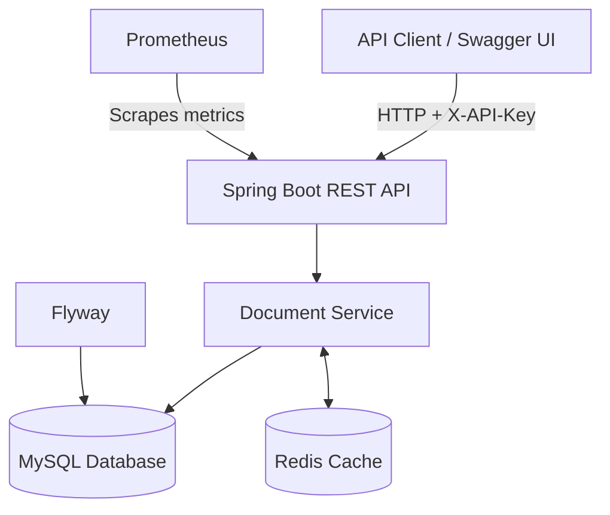

# DocuTrack — Product Document Versioning API

DocuTrack is a cloud-ready REST API built with Java 17 and Spring Boot for managing product-document metadata and tracking file-version history. It combines MySQL persistence, Redis caching, API-key authentication, optimistic concurrency control, database migrations, automated testing, and application monitoring.

The project demonstrates how backend services can manage product documentation while preserving version history and preventing conflicting updates.

## Table of Contents

- [Overview](#overview)
- [Key Features](#key-features)
- [Technology Stack](#technology-stack)
- [Architecture](#architecture)
- [Getting Started](#getting-started)
- [API Reference](#api-reference)
- [Authentication](#authentication)
- [Database and Versioning](#database-and-versioning)
- [Testing](#testing)
- [Monitoring](#monitoring)
- [CI/CD](#cicd)
- [AWS Deployment Architecture](#aws-deployment-architecture)
- [Project Structure](#project-structure)
- [Future Enhancements](#future-enhancements)

## Overview

Product documentation such as technical specifications, installation manuals, engineering drawings, and product configuration records frequently changes throughout a product's lifecycle.

Overwriting documents without retaining previous versions can make auditing, troubleshooting, and rollback difficult.

DocuTrack addresses this problem by separating product-document metadata from version records. It provides API endpoints for creating, searching, updating, and retrieving documents, along with operations for recording and retrieving file-version history.

Each version record can contain a storage key, SHA-256 checksum, content type, file size, and version number. The actual binary file can be stored in an external object-storage service when such an integration is configured.

**Example use case:** A company updates the installation manual for a network switch. DocuTrack can maintain the document's metadata and associate successive file versions with that document, allowing clients to retrieve its version history.

## Key Features

- **Document management:** Create, retrieve, update, search, and paginate product-document records.
- **Version history:** Record file-version metadata and retrieve versions associated with a document.
- **Content integrity:** Store SHA-256 checksums to support verification of file contents.
- **Optimistic concurrency:** Use revision checks and JPA optimistic locking to detect conflicting updates.
- **Redis caching:** Cache document reads and fall back to the database when the cache is unavailable, as implemented by the application.
- **API-key authentication:** Protect API endpoints using the `X-API-Key` request header.
- **Input validation:** Validate requests and return structured error responses.
- **Database migrations:** Manage schema changes using Flyway.
- **Automated testing:** Test API and service behavior with JUnit, Mockito, MockMvc, and H2.
- **Application monitoring:** Expose health information and Prometheus-compatible metrics.
- **Containerization:** Run the application and supporting services with Docker Compose.
- **CI/CD configuration:** Provide GitHub Actions and Jenkins pipeline configuration.

## Technology Stack

| Category | Technologies |
|---|---|
| Language | Java 17 |
| Backend | Spring Boot 3, Spring Web, Spring Data JPA, Spring Security |
| Database | MySQL 8 |
| Caching | Redis 7 |
| Database migrations | Flyway |
| API documentation | OpenAPI, Swagger UI |
| Testing | JUnit 5, Mockito, MockMvc, H2 |
| Coverage | JaCoCo |
| Containers | Docker, Docker Compose |
| Monitoring | Spring Boot Actuator, Micrometer, Prometheus |
| CI/CD | GitHub Actions, Jenkins |
| Cloud architecture | AWS ECS, ECR, RDS, ElastiCache, S3 |

## Architecture



### Architecture components

- **Spring Boot REST API:** Exposes document and version-management endpoints.
- **Document service:** Handles business logic, validation, revision checks, and persistence operations.
- **MySQL:** Stores document metadata and version records.
- **Redis:** Provides caching for supported read operations.
- **Flyway:** Applies database schema migrations.
- **Prometheus:** Collects application metrics exposed by the configured monitoring endpoints.
- **Swagger UI:** Allows developers to explore and test the API interactively.

MySQL is the primary source of truth. Redis is a performance optimization rather than the authoritative data store.

## Getting Started

### Prerequisites

Install the following tools:

- Git
- Docker Desktop with Docker Compose
- A web browser

For running the application outside Docker, also install Java 17 and Maven 3.9 or later.

### 1. Clone the repository

```bash
git clone https://github.com/YOUR-USERNAME/DocuTrack.git
cd DocuTrack
```

Replace `YOUR-USERNAME/DocuTrack` with the actual repository URL.

### 2. Configure environment variables

Create your local environment file from the example:

**Windows Command Prompt:**

```cmd
copy .env.example .env
```

**PowerShell, Linux, or macOS:**

```bash
cp .env.example .env
```

Open `.env` and configure the database credentials and API key required by your Compose configuration.

Example variable names:

```dotenv
MYSQL_DATABASE=DocuTrack
MYSQL_USER=DocuTrack
MYSQL_PASSWORD=replace-with-a-strong-password
MYSQL_ROOT_PASSWORD=replace-with-a-strong-root-password
API_KEY=replace-with-a-long-random-secret
```

These values are examples only. Use credentials appropriate for your local environment and ensure that the names match the variables referenced by `docker-compose.yml` and the application configuration.

Do not commit `.env` or publish real credentials.

### 3. Start the application

```bash
docker compose up --build -d
```

Check the container status:

```bash
docker compose ps
```

Inspect application logs if startup fails:

```bash
docker compose logs app --tail 100
```

Wait until the application has completed startup and its health check reports a healthy state.

### 4. Access the services

With the default port mapping, the API uses host port `8080`. If that port is already occupied, change the host-side mapping in `docker-compose.yml`, for example to `8081:8080`.

| Service | Local URL |
|---|---|
| Swagger UI | `http://localhost:8080/swagger-ui/index.html` |
| Application health | `http://localhost:8080/actuator/health` |
| Prometheus metrics | `http://localhost:8080/actuator/prometheus` |
| Prometheus UI | `http://localhost:9090` |

If you changed the API host port to `8081`, use `http://localhost:8081` for the API endpoints above.

The Prometheus UI is available only when the corresponding container is running and its port is mapped.

### 5. Stop the application

```bash
docker compose down
```

This stops and removes the Compose containers and network while normally preserving named volumes.

**Warning:** `docker compose down -v` also removes the Compose-managed volumes and can delete local database data. Use it only when you intentionally want to reset the local environment.

## API Reference

All endpoints under `/api/v1/` require the configured API key in the `X-API-Key` header.

| Method | Endpoint | Purpose |
|---|---|---|
| POST | `/api/v1/documents` | Create a document |
| GET | `/api/v1/documents` | List, search, and paginate documents |
| GET | `/api/v1/documents/{id}` | Retrieve a document by ID |
| PUT | `/api/v1/documents/{id}` | Update document metadata |
| POST | `/api/v1/documents/{id}/versions` | Add a file-version record |
| GET | `/api/v1/documents/{id}/versions` | Retrieve document version history |

Consult Swagger UI or `requests.http` for the exact request schemas and supported query parameters.

### Example: Create a document

**Request**

```http
POST /api/v1/documents
Content-Type: application/json
X-API-Key: YOUR_API_KEY
```

```json
{
  "productCode": "EDGE-SWITCH-001",
  "name": "Edge Switch Installation Guide",
  "description": "Installation and configuration documentation"
}
```

**Expected result:** a successful creation response containing a generated document ID, document metadata, status, and revision.

The actual HTTP status and response fields are defined by the running application.

### Example: Search documents

```http
GET /api/v1/documents?query=edge
X-API-Key: YOUR_API_KEY
```

The endpoint supports document listing and search. Refer to the implementation for its exact pagination parameters and search behavior.

### Example: Update document metadata

An update request uses the document's expected revision to detect stale changes. The exact request schema is available through Swagger UI.

For example, a request schema that includes these fields could look like:

```json
{
  "name": "Edge Switch Installation Guide",
  "description": "Updated installation documentation",
  "status": "ACTIVE",
  "expectedRevision": 0
}
```

If the document has already changed and the supplied revision is stale, the API is designed to reject the conflicting update rather than silently overwrite newer metadata.

### Example: Retrieve version history

```http
GET /api/v1/documents/{id}/versions
X-API-Key: YOUR_API_KEY
```

Replace `{id}` with an existing document ID.

The endpoint retrieves version records associated with the document. The returned fields depend on the application's response DTO.

## Authentication

The API uses an API key supplied through the `X-API-Key` header.

In Swagger UI:

1. Open the **Authorize** dialog.
2. Enter the value configured by `API_KEY` in your local `.env` file.
3. Click **Authorize**.
4. Execute an API request.

Example request header:

```http
X-API-Key: YOUR_API_KEY
```

Generate a unique random secret for your own environment. Do not use an example key or publish the real value in source code, screenshots, commits, or public documentation.

## Database and Versioning

Flyway migrations are located under:

```text
src/main/resources/db/migration/
```

The initial migration creates the document and version tables, together with the migration-history table maintained by Flyway.

### Document metadata

The `product_documents` table stores fields such as:

- Document ID
- Product code
- Name and description
- Status
- Revision
- Creation and update timestamps

### Version records

The `document_versions` table stores version-related metadata, including:

- Associated document ID
- Version number
- Storage key
- SHA-256 checksum
- Content type
- File size

Version records are intended to preserve historical file-version metadata. The current API's operations and persistence implementation determine the exact immutability guarantees.

**Storage note:** A storage key is a reference to content, not the file itself. An actual S3 upload/download integration should not be assumed unless it has been implemented and configured.

## Testing

Run the Maven verification lifecycle:

```bash
mvn clean verify
```

This compiles the project and executes the configured verification and test phases.

The repository includes unit and API tests using JUnit, Mockito, MockMvc, and H2.

The JaCoCo HTML report is available at:

```text
target/site/jacoco/index.html
```

The report is generated only if the relevant coverage configuration and Maven goals complete successfully.

Recommended manual API tests:

1. Create a document and confirm the successful response.
2. Retrieve the created document using its ID.
3. Search for the document by product code or supported query.
4. Update metadata with the current revision.
5. Submit a stale revision and verify conflict handling.
6. Create a version using the request schema exposed by Swagger.
7. Retrieve the version history and verify the new record.
8. Send an invalid API key and verify authentication rejection.

## Monitoring

Spring Boot Actuator provides health information and metrics through configured management endpoints.

Useful local endpoints include:

- `/actuator/health`
- `/actuator/prometheus`

Prometheus uses the configuration in `monitoring/prometheus.yml` to scrape the configured target.

Open the Prometheus UI at `http://localhost:9090` to query metrics. Available metrics depend on the application's Micrometer configuration and the scrape target's health.

## CI/CD

The repository includes configuration for GitHub Actions and Jenkins.

These configurations provide a foundation for automating build and test workflows. Successful execution depends on the pipeline configuration, repository permissions, runner environment, and any configured secrets.

Before presenting CI/CD as operational, verify that the pipeline has run successfully in the target repository.

## AWS Deployment Architecture

The repository includes a proposed AWS architecture documented in `docs/aws-architecture.md`.

The design can use:

- **Application Load Balancer:** Routes incoming HTTP or HTTPS requests.
- **Amazon ECS with Fargate:** Runs containerized application tasks.
- **Amazon ECR:** Stores container images.
- **Amazon RDS for MySQL:** Provides managed relational database storage.
- **Amazon ElastiCache for Redis:** Provides managed caching.
- **Amazon S3:** Stores document binaries when an object-storage integration is implemented.
- **AWS Secrets Manager:** Stores sensitive configuration.
- **Amazon CloudWatch:** Collects logs, metrics, and operational signals.

This architecture is a deployment design, not evidence of a currently provisioned AWS environment. Deployment requires infrastructure configuration, networking, IAM permissions, secrets, and appropriate security controls.

## Project Structure

```text
DocuTrack/
├── .github/
│   ├── workflows/
│   └── ...
├── docs/
│   └── aws-architecture.md
├── monitoring/
│   └── prometheus.yml
├── src/
│   ├── main/
│   │   ├── java/com/tanmaysharma/DocuTrack/
│   │   │   ├── api/
│   │   │   ├── config/
│   │   │   ├── domain/
│   │   │   ├── exception/
│   │   │   ├── repository/
│   │   │   ├── security/
│   │   │   └── service/
│   │   └── resources/
│   │       ├── db/migration/
│   │       └── application.yml
│   └── test/
├── .env.example
├── .gitignore
├── docker-compose.yml
├── Dockerfile
├── Jenkinsfile
├── pom.xml
├── README.md
└── requests.http
```

Generated files such as `target/` and local secrets such as `.env` should be excluded from version control.

## Future Enhancements

Potential next steps include:

- Integrate Amazon S3 for actual binary upload and retrieval.
- Generate presigned URLs for controlled file access.
- Introduce OAuth 2.0 or another stronger identity mechanism where required.
- Add integration tests using Testcontainers.
- Publish audit events for document and version operations.
- Add rate limiting and improved API abuse protection.
- Provision AWS infrastructure using Terraform.
- Build a separate frontend for document management and version-history visualization.

## Resume Description

**DocuTrack — Product Document Versioning API**

- Developed REST APIs using Java 17 and Spring Boot for product-document management, search, and file-version history.
- Implemented MySQL persistence, Flyway migrations, Redis caching, optimistic concurrency control, API-key authentication, and structured exception handling.
- Created automated tests using JUnit, Mockito, and MockMvc, with Maven-based verification and JaCoCo coverage reporting.
- Containerized the application with Docker Compose and configured health checks and Prometheus-compatible monitoring.
- Documented a proposed AWS deployment architecture using ECS, ECR, RDS, ElastiCache, and S3.

Only retain the technologies and capabilities that are actually implemented and tested in the repository. Describe AWS as a proposed architecture unless you have deployed and verified it.
