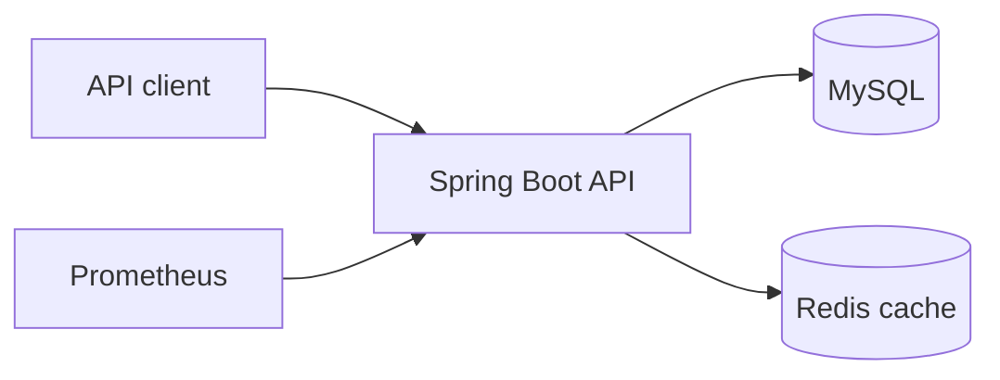

# DesignLedger

DesignLedger is a cloud-ready product-data versioning API built with Java 17 and Spring Boot. It manages searchable product-document metadata and an immutable history of file versions while demonstrating database migrations, caching, optimistic concurrency, automated testing, observability, and CI/CD.

## Why this project exists

Engineering teams frequently update drawings, manuals, specifications, and other product files. Overwriting those files makes audits and rollback difficult. DesignLedger keeps mutable product metadata separate from immutable file-version records. The API stores a content checksum and storage key for every version; the binary itself can live in durable object storage such as Amazon S3.

## Features

- Create, retrieve, update, and search product-document metadata
- Record immutable file versions with SHA-256 checksums
- Prevent lost updates through JPA optimistic locking and explicit revision checks
- Cache document reads in Redis with database fallback if Redis is unavailable
- Protect API routes with a constant-time API-key check
- Validate inputs and return structured API errors
- Apply repeatable database changes with Flyway
- Publish health endpoints and Prometheus-compatible metrics
- Run unit and integration tests with JUnit, Mockito, MockMvc, H2, and JaCoCo
- Build continuously with GitHub Actions or Jenkins
- Run the complete local stack through Docker Compose

## Architecture



MySQL is the source of truth. Redis is only an optimization; cache failures do not prevent database reads. Version records have no update or delete endpoint, which makes their immutability explicit at the API boundary.

## Technology stack

- Java 17, Spring Boot 3, Spring Web, Spring Data JPA, Spring Security
- MySQL 8, Flyway, Redis
- JUnit 5, Mockito, MockMvc, H2, JaCoCo
- Docker, Docker Compose, Jenkins, GitHub Actions
- Spring Boot Actuator, Micrometer, Prometheus
- OpenAPI and Swagger UI

## Run with Docker Compose

Prerequisites: Docker Desktop or Docker Engine with the Compose plugin.

```bash
cp .env.example .env
docker compose up --build
```

Then open:

- Swagger UI: `http://localhost:8080/swagger-ui.html`
- Health: `http://localhost:8080/actuator/health`
- Prometheus metrics: `http://localhost:8080/actuator/prometheus`
- Prometheus UI: `http://localhost:9090`

Swagger's **Authorize** button expects the value configured as `API_KEY` in `.env`. The development default is `local-development-key`; never use it outside a local environment.

Stop the stack with `docker compose down`. Add `-v` only when you intentionally want to delete the local MySQL and Redis volumes.

## Run from VS Code

1. Install Java 17, Maven 3.9+, MySQL 8, and Redis 7.
2. Install the VS Code **Extension Pack for Java** and **Spring Boot Extension Pack**.
3. Start only the dependencies with `docker compose up mysql redis` if Docker is available.
4. Export `DB_PASSWORD`, `DB_USERNAME`, `DB_URL`, `REDIS_HOST`, and `API_KEY`, or use the safe local defaults from `application.yml`.
5. Run `mvn spring-boot:run`, or launch `DesignLedgerApplication` from VS Code.

## Test and package

```bash
mvn clean verify
```

The test suite covers service behavior, duplicate detection, stale-revision conflicts, API-key rejection, request validation, and an end-to-end create/read flow. JaCoCo writes its HTML report to `target/site/jacoco/index.html`.

## API overview

| Method | Endpoint | Purpose |
|---|---|---|
| POST | `/api/v1/documents` | Create product metadata |
| GET | `/api/v1/documents/{id}` | Read one document |
| GET | `/api/v1/documents?query=edge` | Search and paginate |
| PUT | `/api/v1/documents/{id}` | Update metadata using `expectedRevision` |
| POST | `/api/v1/documents/{id}/versions` | Append an immutable file version |
| GET | `/api/v1/documents/{id}/versions` | List version history, newest first |

Every `/api/v1/**` call requires an `X-API-Key` header. Ready-to-run requests are available in [`requests.http`](requests.http).

### Optimistic concurrency example

A document response contains a `revision`. A client must send that value as `expectedRevision` when updating metadata:

```json
{
  "name": "Edge Switch Installation Guide",
  "description": "Updated installation guide",
  "status": "ACTIVE",
  "expectedRevision": 0
}
```

If another request has already changed the record, DesignLedger returns HTTP `409 Conflict` instead of silently overwriting the newer data.

## Repository structure

```text
src/main/java/       API, service, domain, repository, security, and configuration
src/main/resources/  Runtime configuration and Flyway migrations
src/test/            Unit and integration tests
.github/workflows/   GitHub Actions CI pipeline
docs/                AWS production architecture
monitoring/          Prometheus scrape configuration
```

## AWS design

The proposed production topology uses an Application Load Balancer, ECS Fargate, ECR, RDS MySQL, ElastiCache Redis, S3, Secrets Manager, and CloudWatch. See [`docs/aws-architecture.md`](docs/aws-architecture.md) for the diagram, security boundaries, and trade-offs. This repository documents the architecture; it does not claim that a live AWS environment has been provisioned.

## Points

1. **Why immutable versions?** They preserve auditability and eliminate accidental history rewrites.
2. **Why both an explicit revision and `@Version`?** The request-level check gives clients a clear conflict message, while JPA's optimistic lock still protects against a race between concurrent transactions.
3. **Why Redis?** Product metadata is read frequently and changes less often. Cache eviction occurs on update, while failures degrade safely to MySQL.
4. **Why store only an object key?** Databases are efficient for searchable metadata; S3 is more durable and cost-effective for large binaries.
5. **What would come next?** Presigned S3 URLs, OAuth 2.0, integration tests with Testcontainers, audit events, rate limiting, and Terraform-managed AWS infrastructure.

## description

- Developed REST APIs using Java and Spring Boot to manage product metadata, document search, and immutable file-version history.
- Implemented MySQL persistence, Flyway migrations, Redis caching, optimistic concurrency control, API-key authentication, input validation, and structured exception handling.
- Created automated tests using JUnit and Mockito and integrated test execution into CI/CD pipelines using Jenkins and GitHub Actions.
- Containerized the application using Docker, exposed health and Prometheus-compatible metrics through Spring Boot Actuator, and documented an AWS deployment architecture using ECS, ECR, RDS, ElastiCache, and S3.

