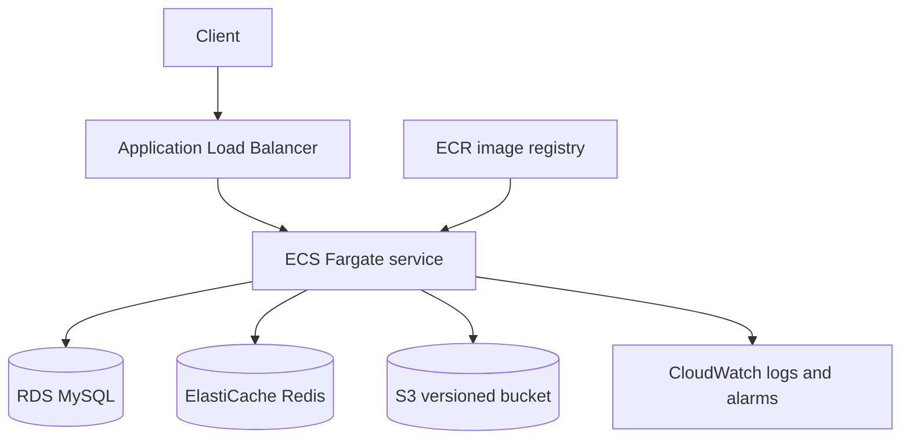

# AWS deployment design

This repository runs locally with Docker Compose. The following is a production-oriented AWS design; it is intentionally documented rather than claimed as a live deployment.

## Component mapping

| Local component | AWS service | Reason |
|---|---|---|
| Spring Boot container | ECS Fargate | Managed container execution and horizontal scaling |
| Docker image | ECR | Private image registry |
| MySQL | RDS for MySQL, Multi-AZ | Automated backups, patching, and failover |
| Redis | ElastiCache for Redis | Managed cache with replication |
| Versioned binary files | S3 with versioning and SSE-KMS | Durable object storage and recovery |
| Application logs | CloudWatch Logs | Central search, retention, and alarms |
| Secrets | Secrets Manager | Rotation and removal of credentials from task definitions |

## Network and security

- Place the load balancer in public subnets and ECS tasks, RDS, and ElastiCache in private subnets.
- Permit inbound traffic to ECS only from the load-balancer security group.
- Permit database and Redis traffic only from the ECS security group.
- Store the API key and database password in Secrets Manager.
- Give the ECS task role access only to the required S3 prefix and CloudWatch log group.
- Enable TLS at the load balancer with an ACM certificate.

## Production improvements

The current API stores object metadata and an S3-compatible storage key. A production increment would issue short-lived presigned S3 upload/download URLs, validate the uploaded checksum, enable WAF rate limiting, and replace the shared API key with OAuth 2.0 or workload identity.
